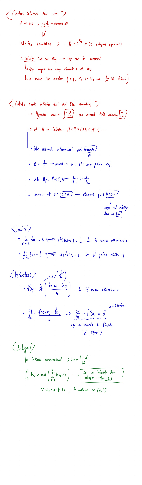

# quirky-thoughts
random math/physics-related gathering

## Monad (hyperreal number)

  

## Physics: C

Self-study notes for AP Physics C, mainly written in Grade 11. A few small diagrams were adapted from online sources.

  

  

  

  

  

  

  

  

  

  

  

  

  

  

## Modulus

